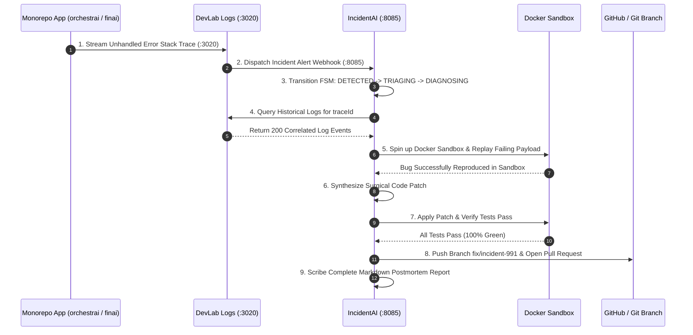

# IncidentAI — Master Product Specification, Technical Dossier & Operations Manual

---

## 1. Product File: Strategic Vision & Autonomous SRE Mandate

### 1.1 Executive Product Summary

**IncidentAI** is the autonomous SRE Incident Commander, root-cause diagnosis engine, and automated self-healing platform for the DevLab multi-repo ecosystem (`orchestrai`, `finai`, `devlab-portal`, `devlab-logs`).

When outages occur in distributed AI systems or fintech platforms, human on-call engineers spend precious minutes waking up, correlating log traces, and parsing stack traces before writing a fix. IncidentAI eliminates this mean time to repair (MTTR) latency through autonomous closed-loop SRE primitives:

1. **Deterministic Incident State Machine (FSM)**: Manages incidents through a formal lifecycle (`DETECTED` -> `TRIAGING` -> `DIAGNOSING` -> `REMEDIATING` -> `VERIFYING` -> `RESOLVED`), ensuring zero chaos or hallucinated actions during triage.
2. **Context-Aware Root-Cause Diagnosis (RCA)**: Automatically fetches correlating logs from DevLab Logs, inspects recent git commits, and analyzes error call-stacks to isolate the exact commit, file, and function causing the failure.
3. **Isolated Sandbox Reproduction**: Replays the failing payload inside an ephemeral Docker sandbox to safely reproduce the defect without exposing production databases or traffic.
4. **Autonomous Code Repair & Branch Synthesis**: Synthesizes verified code patches, applies them to an isolated git branch (`fix/incident-...`), runs full test suites, and opens pull requests for human review.
5. **Automated Postmortem Scribe**: Automatically authors exhaustive markdown postmortem documents with incident timelines, root causes, 5 Whys analysis, and preventive action items.

### 1.2 Target Personas & Primary Use Cases

| Persona                             | Operational Context                                               | Primary Pain Points Addressed                                                                                           |
| :---------------------------------- | :---------------------------------------------------------------- | :---------------------------------------------------------------------------------------------------------------------- |
| **Site Reliability Engineer (SRE)** | On-call triage during critical production outages                 | Accelerates root-cause discovery from hours to seconds; automatically isolates noisy logs and suggests verified fixes.  |
| **Engineering Leader / VP**         | Managing platform reliability, SLAs, and post-incident compliance | Guarantees that every production incident has a structured, blameless postmortem report with concrete prevention tasks. |
| **DevOps / Platform Engineer**      | Maintaining CI/CD and production container deployments            | Provides automated crash reproduction in isolated sandboxes before applying hotfixes.                                   |
| **Backend Developer**               | Debugging edge-case exceptions reported by users                  | Receives ready-to-merge pull requests with regression tests reproducing the exact failure mode.                         |

---

## 2. Exhaustive Feature Directory & Technical Mechanics

```
┌────────────────────────────────────────────────────────────────────────────────────────────────────────┐
│                                   INCIDENTAI PLATFORM TOPOLOGY                                         │
└────────────────────────────────────────────────────────────────────────────────────────────────────────┘
          [Webhook Ingress (:8085)]               [SRE CLI: incidentai triage]
                      │                                        │
                      └───────────────────┬────────────────────┘
                                          ▼
                      [Deterministic Incident State Machine (FSM)]
               DETECTED ──► TRIAGING ──► DIAGNOSING ──► REMEDIATING
                                              ▲              │
                                         (fail)│              ▼
                                          VERIFYING ◄────────┘
                                               │
                                            (pass)
                                               ▼
                                           RESOLVED
                                               │
     ┌─────────────────────────┬───────────────┴───────────────┬─────────────────────────┐
     ▼                         ▼                               ▼                         ▼
[Diagnosis Subsystem]     [Sandbox Runner]            [Automated Repair Engine] [Postmortem Scribe]
 • Log Correlator (:3020)  • Ephemeral Docker Sandbox  • Code Patch Synthesis    • 5 Whys Analysis
 • Git Commit Diff Inspector• Safe Fault Reproduction  • Automated Branch PR     • Action Item Tracker
 • Stack Trace De-obfuscate• Zero Production Leakage   • Regression Test Run     • Markdown Report Export
```

### 2.1 Core Subsystem Breakdown

#### 1. Deterministic Incident FSM (`src/fsm`)

- **Technology Stack**: TypeScript, State Machine Pattern, `@yuva-devlab/shared-types`.
- **Purpose**: Controls every incident transition through mathematical state invariants.
- **Detailed States**:
  - `DETECTED`: Incident logged via webhook from DevLab Logs or microservice alert.
  - `TRIAGING`: Deduplicates events, assigns severity (`SEV1` through `SEV4`), and checks deduplication keys.
  - `DIAGNOSING`: Queries DevLab Logs and correlates recent git commits.
  - `REMEDIATING`: Generates candidate code patches and configuration tweaks.
  - `VERIFYING`: Re-runs failure reproduction in sandbox to verify the fix works.
  - `RESOLVED`: Emits resolved notification, opens PR, and dispatches the postmortem report.

#### 2. Root-Cause Diagnosis Subsystem (`src/diagnosis`)

- **Detailed Features**:
  - Automatically queries DevLab Logs (`:3020`) for all log lines sharing the incident's `traceId`.
  - Analyzes git history using `git log --since` to correlate recent code deployments with error onset.
  - Uses AI reasoning models to identify the exact line of code and logical error causing the failure.

#### 3. Sandbox Reproduction Runner (`src/sandbox`)

- **Technology Stack**: Docker API, ephemeral Linux containers.
- **Detailed Features**:
  - Spins up isolated execution environments with network isolation.
  - Replays the exact request payload that triggered the crash to confirm reproduction.

#### 4. Automated Code Repair Engine (`src/repair`)

- **Detailed Features**:
  - Generates minimal, surgical code diffs fixing the underlying bug.
  - Creates a dedicated branch (`fix/incident-<id>`), commits the patch, and triggers CI.

#### 5. Postmortem Scribe (`src/postmortem`)

- **Detailed Features**:
  - Automatically writes a comprehensive, blameless postmortem markdown file.
  - Includes: Incident Summary, Impact Metrics (Downtime, affected tenants), Chronological Timeline, Root Cause Analysis, 5 Whys, and Preventative Action Items.

#### 6. Webhook Ingestion Service (`src/index.ts` — Port `8085`)

- **Technology Stack**: Fastify v4, TypeScript Node ESM.
- **Purpose**: Listens for error alerts and exceptions dispatched by `orchestrai`, `finai`, `devlab-portal`, or `devlab-logs`.

---

## 3. Inter-System Ecosystem Collaboration ("How It Works With Others")



### 3.1 Inter-Repository Integration Matrix

| Ecosystem Member    | Direction | Protocol & Transport   | Purpose & Operational Behavior                                                                    |
| :------------------ | :-------: | :--------------------- | :------------------------------------------------------------------------------------------------ |
| **`devlab-logs`**   |  Inbound  | HTTP/2 REST (`:3020`)  | Queries correlated trace logs and historical telemetry during automated root-cause diagnosis.     |
| **`orchestrai`**    |  Inbound  | HTTP Webhook (`:8085`) | Receives crash alerts, worker timeouts, and tool sandbox exceptions for automated triage.         |
| **`finai`**         |  Inbound  | HTTP Webhook (`:8085`) | Receives banking sync exceptions and ledger invariant violations for immediate SRE investigation. |
| **`devlab-portal`** |  Inbound  | HTTP Webhook (`:8085`) | Monitors control plane health and alert drops.                                                    |
| **`devlab-guard`**  |  Inbound  | CLI Git Pre-commit     | Enforces the 250-line rule, strict enums, and code quality before commit.                         |
| **`devlab-shared`** |  Static   | npm Package Imports    | Consumes `@yuva-devlab/errors`, `@yuva-devlab/resilience`, and `@yuva-devlab/logger`.             |

---

## 4. Technical Guidelines & Invariant Rules

### 4.1 Prime Non-Negotiable Invariants

1. **Deterministic FSM Transitions**:
   - State machine transitions must be strictly enforced; state cannot jump arbitrarily (e.g. `DETECTED` cannot transition directly to `RESOLVED` without verification).
2. **Zero Production Mutation**:
   - IncidentAI is NEVER permitted to mutate production databases or directly commit to production branches (`main` or `dev`). All fixes must be proposed as pull requests.
3. **Hard 250-Line Maximum Rule**:
   - No source file across `src/*` may exceed 250 lines. Decompose early at 200 lines.
4. **Canonical Enums Only**:
   - All incident severities (`SEV1`, `SEV2`, `SEV3`, `SEV4`) and states must use strict TypeScript enums.

---

## 5. Developer Usage Guidelines & Operations Manual

### 5.1 Local Prerequisites & Setup

```bash
# Clone the repository
git clone https://github.com/yuvadevlab/incidentai.git
cd incidentai

# Install dependencies
pnpm install

# Start Webhook Receiver in development mode (:8085)
pnpm dev

# Build the project
pnpm build
```

### 5.2 Complete Environment Variables Reference

| Variable          |  Type  |            Default            | Required | Description                                         |
| :---------------- | :----: | :---------------------------: | :------: | :-------------------------------------------------- |
| `PORT`            | Number |            `8085`             |   Yes    | Webhook receiver HTTP port.                         |
| `DEVLAB_LOGS_URL` | String |    `http://localhost:3020`    |   Yes    | DevLab Logs ingestion endpoint for querying traces. |
| `DOCKER_HOST`     | String | `unix:///var/run/docker.sock` |    No    | Docker daemon socket for sandbox reproduction.      |

### 5.3 Simulating an Incident via Webhook Example

```bash
curl -X POST http://localhost:8085/api/v1/incidents/webhook \
  -H "Content-Type: application/json" \
  -d '{
    "service": "orchestrai-worker",
    "severity": "SEV1",
    "title": "Unhandled Memory Allocation Failure in Vector Embedding Sandbox",
    "traceId": "trace_99882233",
    "stackTrace": "FatalError: Out of memory in worker sandbox\n  at VectorEngine.embed (/apps/worker/src/embed.ts:42)",
    "timestamp": "2026-10-08T22:30:00.000Z"
  }'
```
