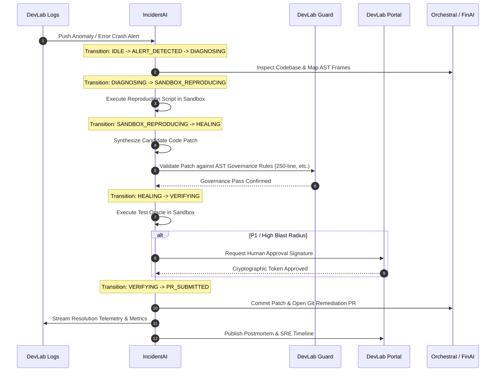

# IncidentAI — Product Specification, Technical Dossier & Operations Manual

---

## 1. Executive Product Dossier & Market Vision

### 1.1 The Operational Problem Space

In mission-critical distributed cloud environments (microservices, multi-region database clusters, autonomous agent swarms), infrastructure downtime is catastrophic:

- **Financial Blast Radius**: Industry benchmarks establish that enterprise downtime exceeds **$300,000 to $540,000 per hour** in lost transactions and SLA penalties.
- **The Human Cognitive Bottleneck**: Traditional incident triage relies on fractured alerts fired via PagerDuty or Opsgenie. Human on-call engineers are awakened at 3:00 AM, log into disparate dashboards (Grafana, Datadog, AWS CloudWatch, Kubernetes consoles), manually parse through gigabytes of logs, formulate speculative hypotheses under stress, and attempt manual mitigation.
- **The "Remediation Roulette"**: Human operators under pressure frequently commit untested patches, trigger bad database rollbacks, or forget cascading dependencies, causing secondary outages.
- **Retrospective Fatigue**: Root Cause Analysis (RCA) and postmortems are frequently delayed or skipped entirely due to on-call burnout, guaranteeing that identical outages recur.

### 1.2 The IncidentAI Value Proposition

**IncidentAI** (formerly Chaos Doctor) is the industry's first **Autonomous AI Site Reliability Engineer and Self-Healing Incident Commander**. It transforms reactive human firefighting into deterministic, autonomous, self-healing system resilience:

1. **Zero Human-Latency Detection**: Telemetry alerts are ingested in real-time from `devlab-logs` and gateway streams.
2. **Deterministic State Machine Governance**: Operates under an immutable Finite State Machine (FSM), ensuring no skipped stages or chaotic interventions.
3. **AST-Driven Forensic Triage**: Stack traces are parsed into exact source-code AST nodes, pinpointing the precise offending file, function, and statement.
4. **Zero-Hallucination Sandboxed Remediation**: AI-generated code patches and mitigation scripts are **never** executed blindly on production. They are synthesized, containerized, and tested inside isolated reproduction sandboxes before human review or deployment.
5. **Human-in-the-Loop (HITL) Authorization Rails**: Enforces cryptographic signing via DevLab Portal for high-blast-radius operations (SEV-1/P1).
6. **Instantaneous Blameless Postmortems**: Reconstructs exact second-by-second incident timelines, computes MTTD, MTTA, and MTTM, and publishes production-ready postmortems and PRs within seconds of mitigation.

---

## 2. Exhaustive Feature Matrix & Deep Technical Explanation

```
┌────────────────────────────────────────────────────────────────────────────────────────┐
│                              INCIDENTAI FEATURE PIPELINE                               │
└────────────────────────────────────────────────────────────────────────────────────────┘
 [Telemetry Stream] ──▶ [1. Ingestion] ──▶ [2. FSM Router] ──▶ [3. AST Forensics]
                                                                     │
 [GitHub PR / Docs] ◀── [6. Postmortem] ◀── [5. Self-Healing] ◀──────┴── [4. Sandbox]
```

### Feature 1: Multi-Protocol Telemetry Alert Ingestion

- **Module**: `src/fsm/alert_listener.ts`
- **Objective**: Intercept alerts, fatal crashes, and metric anomaly spikes across distributed applications without polling overhead.
- **How It Works**:
  - Exposes an HTTP webhook receiver and an event listener streaming directly from `devlab-logs` (Kafka / DuckDB).
  - Validates every incoming alert against `IncidentAlertSchema` using Zod runtime parsing.
  - Normalizes alerts into a canonical `IncidentAlert` entity with unique incident IDs (`inc-<base36>`), service origin, severity level, trace correlation ID, and ISO timestamp.
- **Inputs**: Raw JSON webhook payloads or Kafka event envelopes.
- **Outputs**: Strongly typed `IncidentAlert` instances dispatched to the orchestrator.
- **Failure Recovery**: Malformed alerts are safely routed to a dead-letter log without interrupting active incident pipelines.

### Feature 2: Deterministic Incident Lifecycle FSM

- **Module**: `src/fsm/incident_fsm.ts`
- **Objective**: Prevent unpredictable agent actions by enforcing strict mathematical state transitions.
- **How It Works**:
  - Implements an asynchronous Finite State Machine governing the incident lifecycle:
    ```
    IDLE ──▶ ALERT_DETECTED ──▶ DIAGNOSING ──▶ SANDBOX_REPRODUCING
                                                        │
    PR_SUBMITTED ◀── VERIFYING ◀── HEALING ◀────────────┘
         │
         └──▶ [FAILED] (Fallback to on-call escalation)
    ```
  - Every transition asserts preconditions (e.g. state cannot transition from `DIAGNOSING` to `HEALING` without an approved `DiagnosticReport`).
  - Records duration and state change metadata for retrospective timeline analysis.
- **Inputs**: Transition events emitted by the orchestrator.
- **Outputs**: Immutable state change logs and reactive event callbacks.

### Feature 3: Stack Trace AST Mapping & Forensic Analysis

- **Module**: `src/diagnosis/log_correlator.ts` & `src/diagnosis/ast_mapper.ts`
- **Objective**: Connect runtime telemetry crashes directly to concrete source code locations in the repository.
- **How It Works**:
  - `log_correlator.ts` extracts raw stack traces from alert text, parsing frames into structured tuples: `{ file, line, column, functionName }`.
  - `ast_mapper.ts` resolves relative paths to absolute monorepo targets, extracts surrounding source code snippets (10 lines before and after), and maps the execution frame to the Abstract Syntax Tree.
- **Inputs**: Stack trace strings and repository file paths.
- **Outputs**: `DiagnosticReport` containing parsed frames, target code snippet, and affected symbols.

### Feature 4: Hypothesis Generation Engine

- **Module**: `src/diagnosis/hypothesis_engine.ts`
- **Objective**: Analyze the correlated failure and formulate prioritized root-cause hypotheses with confidence metrics.
- **How It Works**:
  - Evaluates exception patterns (e.g., connection pool starvation, memory leaks, unhandled null pointers, deadlocks).
  - Synthesizes 3-5 ranked hypotheses explaining _why_ the crash occurred, citing exact lines of code.
- **Inputs**: `DiagnosticReport` snippet and error message.
- **Outputs**: Scored hypothesis list attached to the `DiagnosticReport`.

### Feature 5: Ephemeral Sandbox Reproduction & Test Oracle

- **Module**: `src/sandbox/reproduction_spec.ts`, `src/sandbox/sandbox_runner.ts`, `src/sandbox/test_oracle.ts`
- **Objective**: Guarantee zero-hallucination fixes by reproducing the failure in isolation before attempting any repair.
- **How It Works**:
  - `reproduction_spec.ts` compiles an executable reproduction script simulating the exact runtime inputs that triggered the crash.
  - `sandbox_runner.ts` provisions an isolated execution context (timeout-bounded child process or container), executes the reproduction spec, and captures exit codes, stdout, and stderr.
  - `test_oracle.ts` verifies that the failure reproduces faithfully (exit code $\neq 0$ or specific error logged).
- **Inputs**: Reproduction script and target repository environment.
- **Outputs**: `SandboxResult` verifying whether the failure is actively reproducible.

### Feature 6: Autonomous Patch Synthesis & Self-Correction Feedback Loop

- **Module**: `src/repair/patch_synthesizer.ts` & `src/repair/feedback_loop.ts`
- **Objective**: Author surgical code repairs and iterate until the sandbox test passes.
- **How It Works**:
  - `patch_synthesizer.ts` analyzes the code snippet and diagnosis report to synthesize a unified git diff patch.
  - `feedback_loop.ts` applies the patch inside the isolated sandbox, then re-runs the reproduction test suite.
  - If the test passes, the patch is promoted to verification. If it fails, the error output is fed back into the synthesizer for up to 3 iterative self-correction attempts.
- **Inputs**: Failed reproduction result, code snippet, and hypothesis.
- **Outputs**: `RepairOutcome` containing the verified `PatchCandidate` or an escalation error.

### Feature 7: Git Automation & PR Publication

- **Module**: `src/repair/git_committer.ts` & `src/postmortem/pr_generator.ts`
- **Objective**: Package verified fixes into production-ready Git pull requests without human manual branch management.
- **How It Works**:
  - Checks out a dedicated remediation branch (`fix/incident-<id>-<timestamp>`).
  - Writes the verified patch, stages changes, and creates a commit formatted according to Conventional Commits: `fix(<service>): remediate <title>`.
  - Emits formatted GitHub PR markdown with reproduction evidence and test logs.
- **Inputs**: `PatchCandidate` and incident metadata.
- **Outputs**: Created Git branch and published pull request.

### Feature 8: SRE Postmortem Scribe & Timeline Reconstruction

- **Module**: `src/postmortem/timeline_builder.ts`
- **Objective**: Compile blameless Google SRE-style postmortem documents immediately upon resolution.
- **How It Works**:
  - Reconstructs an exact chronological timeline from the FSM state logs.
  - Computes operational metrics:
    - **MTTD (Mean Time to Detect)**: Timestamp of failure to alert trigger.
    - **MTTA (Mean Time to Acknowledge)**: Alert trigger to FSM triage transition.
    - **MTTM (Mean Time to Mitigate)**: Triage transition to verified sandbox patch.
  - Outputs a structured Markdown report ready for archiving in the knowledge base.
- **Inputs**: Incident FSM transition history and `RepairOutcome`.
- **Outputs**: `PostMortemReport` and persistent markdown document.

---

## 3. How IncidentAI Interacts with the DevLab Multi-Repo Ecosystem



### Detailed Ecosystem Interaction Matrix

| Ecosystem Member    |   Direction    | Protocol / Transport                           | Data Payload / Contract                                                                                                 |
| :------------------ | :------------: | :--------------------------------------------- | :---------------------------------------------------------------------------------------------------------------------- |
| **`devlab-logs`**   |    Inbound     | HTTP Webhook / Kafka Consumer                  | Streams fatal crash logs, p99 latency spikes, and OOM alerts into `AlertListener`.                                      |
| **`devlab-guard`**  |    Outbound    | REST API (`http://localhost:8080/api/v1/scan`) | Sends synthesized patches to Guard to verify they do not violate the 250-line limit or comment rules before committing. |
| **`devlab-portal`** | Bi-directional | REST API (`http://localhost:3010`) & Socket.IO | Sends real-time incident status to the web portal; polls for human authorization tokens on P1 actions.                  |
| **`orchestrai`**    |    Outbound    | Direct Workspace & gRPC (`:50051`)             | Triages crashes occurring in the orchestrator runtime, repairs agent nodes, and commits git patches.                    |
| **`finai`**         |    Outbound    | Direct Workspace                               | Intercepts financial transaction errors, tests repairs against the finance engine, and commits patches.                 |
| **`devlab-shared`** |     Static     | Internal npm package link                      | Consumes `@yuva-devlab/logger`, `@yuva-devlab/errors`, and `@yuva-devlab/regex` for shared contracts.                   |

---

## 4. Technical Guidelines & Invariants

### 4.1 Language & Tooling Choices

- **TypeScript 5.8 (Node.js ESM)**:
  - Selected for strict compile-time type verification across complex incident states.
  - Zero-transpile rapid execution using `tsx`.
- **Commander CLI (v13)**:
  - Standardized enterprise command-line parsing supporting interactive drills and daemon polling.
- **Zod 3.24**:
  - Runtime validation guarding against malformed alert streams.

### 4.2 Architectural Standards

1. **Hard 250-Line Maximum Rule**: Every file in `src/` must remain strictly under 250 physical lines.
2. **Canonical Snake_Case Enums**: All statuses (`idle`, `alert_detected`, `diagnosing`, `p1_critical`) must use strict canonical enum constants.
3. **Sandbox Isolation Invariant**: No synthesized patch may be committed to a git branch without passing the sandbox reproduction oracle.
4. **Idempotency**: All remediation actions must be safe to re-execute without creating duplicate side-effects.

---

## 5. Complete Usage Runbook & CLI Reference

### 5.1 Installation & Configuration

```bash
# Clone the repository
git clone https://github.com/yuvadevlab/incidentai.git
cd incidentai

# Install dependencies via pnpm
pnpm install

# Build CLI binary
pnpm build
```

### 5.2 Command Reference

#### 1. Autonomous SRE Fire Drill Demo

Runs an end-to-end simulation of a P1 database timeout outage:

```bash
pnpm run demo
# or
node dist/cli.js demo
```

#### 2. Specific Incident Scenario Execution

Triggers remediation for a targeted service and failure scenario:

```bash
node dist/cli.js run --scenario "DB Connection Pool Exhaustion" --service "finai"
```

#### 3. Continuous Telemetry Stream Monitor

Launches the daemon listener streaming crashes from DevLab Logs:

```bash
node dist/cli.js watch
```

### 5.3 Environment Variables Reference

| Variable            | Type   | Default                 | Description                                             |
| :------------------ | :----- | :---------------------- | :------------------------------------------------------ |
| `NODE_ENV`          | String | `development`           | Environment mode (`development`, `production`, `test`). |
| `PORT`              | Number | `8085`                  | HTTP port for incoming alert webhooks.                  |
| `DEVLAB_LOGS_URL`   | String | `http://localhost:3020` | Ingestion endpoint for DevLab Logs telemetry.           |
| `DEVLAB_PORTAL_URL` | String | `http://localhost:3010` | Endpoint for DevLab Portal HITL authorization.          |
| `DEVLAB_GUARD_URL`  | String | `http://localhost:8080` | Endpoint for DevLab Guard AST governance reviews.       |
| `LOG_LEVEL`         | String | `info`                  | Logging verbosity (`debug`, `info`, `warn`, `error`).   |
