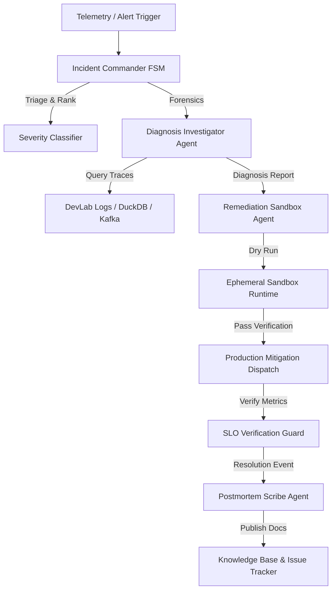

# IncidentAI — Autonomous AI Site Reliability Engineer & Incident Commander

<p align="center">
  
  
  
  
  
</p>

**IncidentAI** is an enterprise-grade autonomous Site Reliability Engineering (SRE) commander and self-healing platform. When production alerts fire, IncidentAI mobilizes an autonomous swarm of specialized agents to triage severity, isolate root causes across distributed logs, simulate remediations in isolated sandboxes, execute verified mitigations, and publish blameless retrospective postmortems.

---

## ⚡ Key Capabilities

- **Deterministic Incident FSM**: Finite State Machine ensuring no stage skipping (`DETECTED` ➔ `TRIAGING` ➔ `DIAGNOSING` ➔ `MITIGATING` ➔ `VERIFYING` ➔ `RESOLVED` ➔ `POSTMORTEM`).
- **Distributed Forensic Triage**: Ingests error bursts and traces across DevLab Logs to cluster repetitive stack traces and identify anomalous latency signatures.
- **Sandboxed Dry-Run Remediation**: Authoring surgical remediation scripts with mandatory ephemeral sandbox validation prior to production application.
- **Human-in-the-Loop (HITL) Rails**: Enforces cryptographic authorization tokens for high-impact infrastructure mutations (`SEV-1`).
- **Automated SRE Postmortems**: Instant timeline reconstruction (MTTD, MTTA, MTTM) and blameless retrospective generation in markdown.

---

## 🏗 System Architecture



---

## 🚀 Quick Start

### Prerequisites

- Node.js `>= 20.0.0`
- pnpm `>= 9.0.0`

### Installation

```bash
# Clone and install dependencies
git clone https://github.com/yuvadevlab/chaos-doctor.git incidentai
cd incidentai
pnpm install
```

### Build & Validate

```bash
# Typecheck TypeScript sources
pnpm typecheck

# Build CLI binary
pnpm build

# Run interactive simulation demo
pnpm demo
```

---

## 💻 CLI Commands

```bash
# Run complete end-to-end incident drill simulation
pnpm run dev demo

# Ingest and triage an active incident
pnpm run dev triage --severity p1_critical --source "api-gateway"

# View incident timeline and postmortems
pnpm run dev postmortem --incident-id inc_demo_101
```

---

## 📁 Repository Structure

```
incidentai/
├── .agents/                    # Specialized AI agent role definitions & guidelines
│   ├── agents/                 # Commander, Diagnostician, Remediator, Scribe
│   └── rules/                  # Core invariants and 250-line rulebook
├── .husky/                     # Git hooks (pre-commit format & commit-msg commitlint)
├── .vscode/                    # VS Code editor settings, watchers, and extensions
├── dist/                       # Compiled production JavaScript bundle
├── src/                        # Clean TypeScript architecture source files
│   ├── cli.ts                  # Commander CLI entrypoint
│   ├── constants/              # System constants and enum definitions
│   ├── fsm/                    # Deterministic Incident Finite State Machine
│   ├── diagnosis/              # Forensics, log clustering, and hypothesis engine
│   ├── sandbox/                # Isolated execution runner and dry-run validator
│   ├── repair/                 # Remediation plan synthesis and action dispatch
│   └── postmortem/             # SRE timeline reconstruction and report compiler
├── commitlint.config.ts        # Conventional commits configuration
├── package.json                # Project manifest and npm scripts
└── tsconfig.json               # Strict TypeScript configuration
```

---

## 📜 Development Guidelines

- **250-Line Maximum Rule**: Every source file in `src/` must remain under 250 lines of code.
- **Conventional Commits**: Every commit message must follow `<type>(<scope>): <subject>` format.
- **Zero Hallucination Remediation**: All mitigation scripts must undergo dry-run execution in sandboxed environments.
